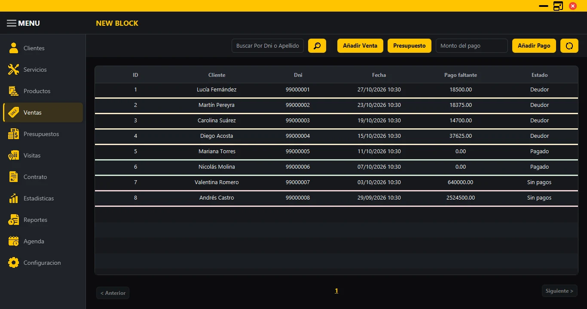
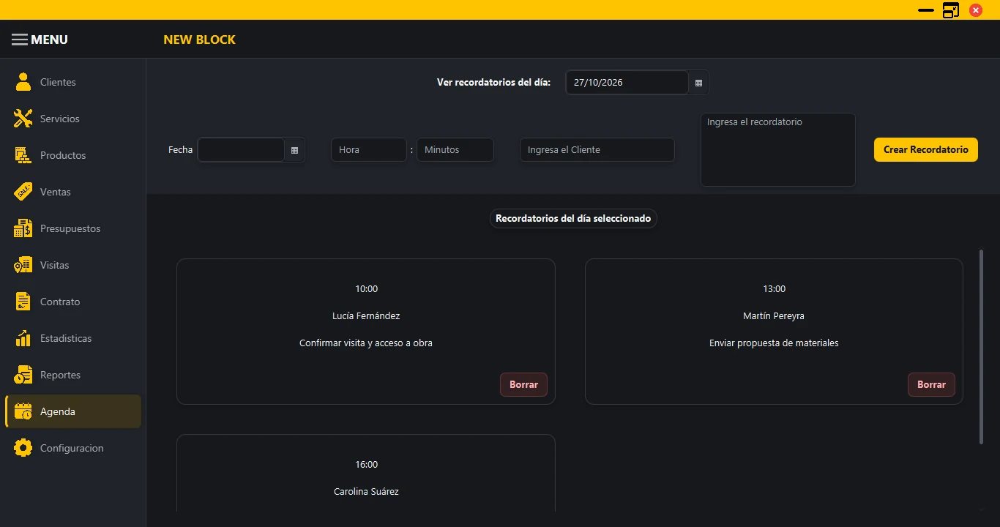

# Newblock · Sistema de gestión

Automatización de presupuestos, documentos y tareas comerciales para una empresa de obras.

| Proyecto | Detalle |
|---|---|
| Tipo | Software a medida para una empresa de obras |
| Estado | En uso en Newblock |
| Tecnologías | Java · JavaFX · Spring Boot · MySQL |
| Desarrollo | Agustin Crudo · Ingenia Software |
| Código de la aplicación | Privado |

Las capturas y el video usan datos de ejemplo.

## El problema

Los vendedores armaban presupuestos con Excel, Canva y notas. Tenían que reunir la información de cada cliente, preparar los documentos a mano y mantener el seguimiento de la venta en distintas herramientas. Ese trabajo se repetía en cada operación y ocupaba una parte importante de su jornada.

## Qué desarrollé

- Generación de presupuestos y documentos PDF a partir de los datos cargados en el sistema.
- Gestión de clientes, productos y servicios para reutilizar la información en cada operación.
- Registro y seguimiento de ventas, pagos, visitas y contratos.
- Agenda y consultas para organizar las tareas de vendedores y administrativos.

## Mi trabajo

Me encargo del desarrollo y de las mejoras del sistema. Defino con Newblock los flujos del programa y voy incorporando las funciones que necesita la empresa.

## Qué cambió en Newblock

El programa reemplazó tareas que los empleados hacían a mano y redujo considerablemente el trabajo de los vendedores. Es el único sistema que utilizan vendedores y administrativos para su actividad diaria. Sigo ampliándolo para que abarque más áreas de la empresa.

## Video

[Ver o descargar el video MP4 · 39 s](assets/recorrido.mp4)

## Más capturas

**Ventas**

**Detalle de venta y pagos**

**Estadísticas**

**Agenda**

## Documentación técnica

- [Arquitectura](docs/arquitectura.md)
- [Decisiones técnicas](docs/decisiones-tecnicas.md)

## Contacto

[Portfolio](https://ingeniasoftwareok.github.io/portfolio/) · [Ingenia Software](https://ingenia-software.com.ar/) · [Email](mailto:ingeniasoftwareok@gmail.com)
