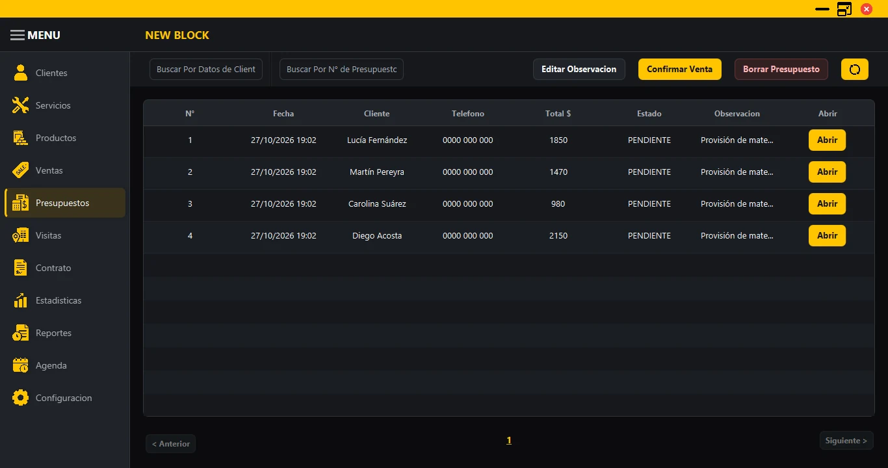
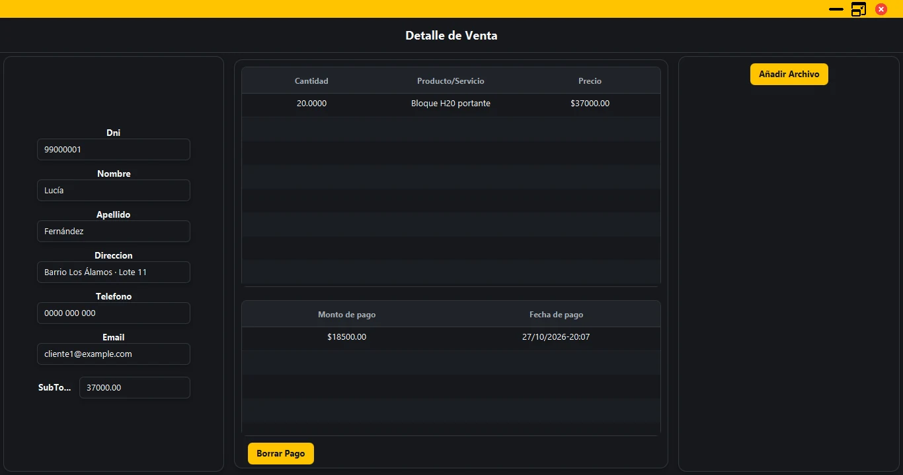
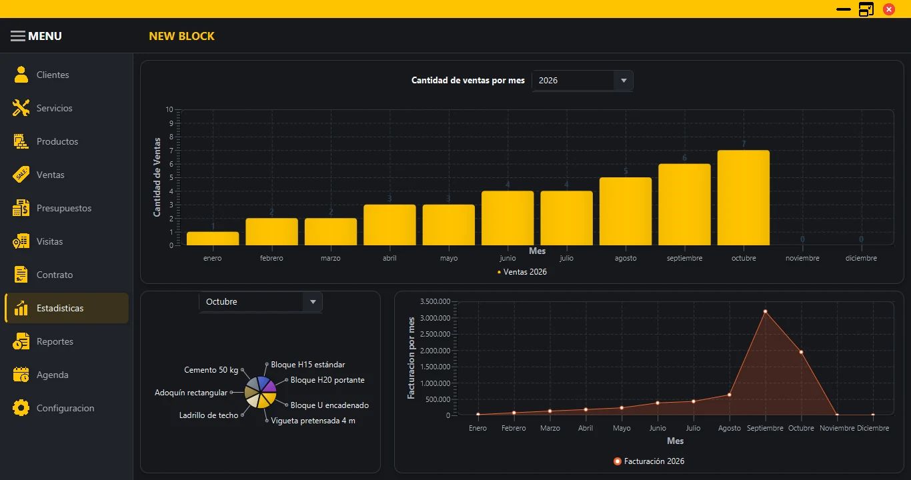

# Gestión para una empresa de obras · Newblock

Presupuestos, operaciones comerciales y seguimiento dentro del sistema que utiliza la empresa.

| Proyecto | Detalle |
|---|---|
| Tipo | Software a medida para una empresa de obras |
| Estado | En uso por vendedores y administrativos. Desarrollo en evolución. |
| Tecnologías | Java · JavaFX · Spring Boot · MySQL |
| Desarrollo | Agustin Crudo · Ingenia Software |
| Código de la aplicación | Privado; este repositorio presenta el caso |

**Material visual de demostración.** Las cifras de las pantallas no son resultados comerciales.

## Recorrido visual

[Ver o descargar el video MP4 · 39 s](assets/recorrido.mp4) · [Descripción del recorrido](docs/recorrido.md) · [Rótulos descriptivos VTT](assets/recorrido.es.vtt)

El recorrido muestra navegación por módulos y consulta de registros con datos ficticios. No muestra generar ni abrir un presupuesto PDF ni constituye una medición de tiempos.

## El problema

Antes se combinaban Excel, Canva y notas para acompañar el trabajo comercial. La preparación individual de presupuestos era una de las tareas que más tiempo demandaba. El desarrollo buscó llevar ese proceso al sistema y reunir la información necesaria para seguir cada operación.

## La solución

- Gestión de clientes, productos y servicios vinculados al trabajo comercial.
- Preparación de presupuestos y documentos asociados desde los datos del sistema.
- Seguimiento de ventas, pagos, visitas, contratos y agenda según el alcance del desarrollo.

## Mi participación

Desarrollo a medida y evolución de la solución bajo Ingenia Software, con un proceso mixto de programación y herramientas de IA. El trabajo se enfoca en comprender las tareas de la empresa e incorporar mejoras sobre el uso real.

## Resultado y estado

El programa se utiliza actualmente como sistema central de las tareas de vendedores y administrativos de Newblock. Continúa ampliándose para extender la cobertura al resto de la empresa.

## Decisiones y alcance

- [Arquitectura simplificada](docs/arquitectura.md)
- [Decisiones técnicas seleccionadas](docs/decisiones-tecnicas.md)
- [Qué demuestra el material y qué queda fuera](docs/alcance-evidencia.md)

Más capturas del proyecto

**Ventas**

**Detalle de venta y pagos**

**Estadísticas de demostración**

**Agenda**

## Disponibilidad del código

Este repositorio contiene documentación y material audiovisual del caso. El código fuente de la aplicación se mantiene privado. Los diagramas son explicaciones simplificadas, no instrucciones de despliegue ni una distribución del sistema.

## Contacto

[Agustin Crudo · Ingenia Software](https://github.com/IngeniaSoftwareok) · [Web profesional](https://ingenia-software.com.ar/) · [Email](mailto:ingeniasoftwareok@gmail.com)
