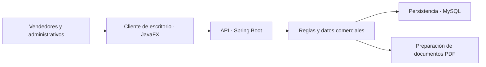

# Arquitectura del caso

Vista simplificada del proyecto; no describe credenciales, servidores ni configuración operativa.

El cliente ofrece las pantallas de operación. El backend concentra servicios y persistencia. La evolución revisada vincula el presupuesto, los datos comerciales y el PDF, preservando la información de la operación.

El repositorio presenta la arquitectura del proyecto revisado. La existencia de una mejora en el código no implica por sí sola que esa revisión esté instalada en todos los equipos.
