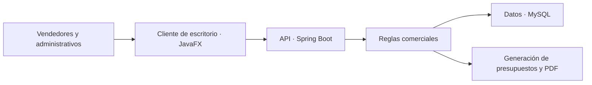

# Arquitectura

Organicé el sistema en un cliente de escritorio para el trabajo diario y un backend que procesa las operaciones comerciales.

## Cliente de escritorio

Las pantallas reúnen clientes, productos, presupuestos, ventas, pagos, visitas, contratos y agenda. El vendedor puede consultar la información y continuar una operación desde el mismo programa.

## Backend

La API recibe las solicitudes del cliente y concentra las reglas comerciales, la persistencia y la generación de documentos. Esta separación me permite modificar una regla sin tener que repetirla en cada pantalla.

## Presupuestos y documentos

El sistema toma los datos de la operación para preparar el presupuesto y generar su PDF. El documento queda vinculado al registro comercial correspondiente, lo que facilita recuperarlo y seguir la venta.
